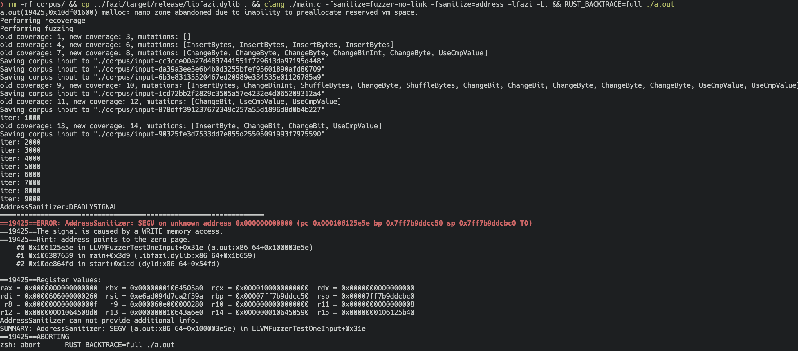

[](https://crates.io/crates/fazi) [](https://docs.rs/fazi)

# Fazi


A reimplementation of libfuzzer in Rust with some improvements

## Supported Features

- [x] libFuzzer's mutations
- [x] SanCov feedback
- [x] Building without a `main()` entry point
- [x] Crash replaying
- [x] Recoverage
- [x] Custom user initialization
- [ ] Scaling/forking support
- [ ] Timeout detection
- [ ] Custom dictionaries
- [ ] Custom user-defined mutations

Anything else that's missing from [libFuzzer's featureset](https://www.llvm.org/docs/LibFuzzer.html#options) will likely not be supported. Feel free to file an issue if you'd like to voice support for something.

## Usage

Step 1: Build fazi (the default `sancov` feature requires Rust nightly):

```bash
$ cargo build --release
```

Cargo features:

- `sancov` (default): SanitizerCoverage runtime for instrumented host code, libc comparison hooks and
  sanitizer integration. Requires nightly. The `hook_*` and `main_entrypoint` features imply it.
- `main_entrypoint`: provides `main()` that drives `LLVMFuzzerTestOneInput`.
- `embed`: API for targets whose execution the host does not instrument, such as emulators (see
  [Embedding](#embedding-fuzzing-emulated-targets)). Builds on stable with `default-features = false`.

Step 2: Build your harness:

```bash
$ FAZI_DIR="../path-to-fazi" clang ./main.c -fsanitize=fuzzer-no-link -fsanitize=address -lfazi -L$FAZI_DIR/target/release/
```

Step 3: Run the harness:

```bash
$ ./a.out
```



You can list command-line options with the `--help` flag:

```text
fazi

USAGE:
    a.out [OPTIONS] [SUBCOMMAND]

OPTIONS:
        --corpus-dir <CORPUS_DIR>
            Location at which inputs that cause new coverage will be saved [default: ./corpus]

        --crashes-dir <CRASHES_DIR>
            Location at which crashing inputs will be saved [default: ./crashes]

    -h, --help
            Print help information

        --len-control <LEN_CONTROL>
            Length control is used in an algorithm for deciding how quickly the input size grows. A
            larger value will result in faster growth while a smaller value will result in slow
            growth [default: 100]

        --max-input-len <MAX_INPUT_LEN>
            The maximum size (in bytes) that an input can extend to [default: 65000]

        --max-iters <MAX_ITERS>
            Maximum number of fuzzing iterations before the fuzzer should exit

        --max-mutation-depth <MAX_MUTATION_DEPTH>
            The maximum number of times to mutate a single input before moving on to another
            [default: 15]

        --seed <SEED>
            RNG seed

SUBCOMMANDS:
    help     Print this message or the help of the given subcommand(s)
    repro    Reproduce some crash
```

### Running the Example Rust Harness

The example pure Rust harness can be found at the [/examples/simple_harness.rs](/examples/simple_harness.rs).

To build/run it, clone the repo and run the following commands:

```bash
cargo rustc --no-default-features --features=hook_builtins --example simple_harness -- \
    -Znew-llvm-pass-manager=no \
    -C passes=sancov \
    -C llvm-args=-sanitizer-coverage-level=3 \
    -C llvm-args=-sanitizer-coverage-inline-8bit-counters \
    -C llvm-args=-sanitizer-coverage-trace-compares \
    -C llvm-args=-sanitizer-coverage-pc-table \
    -Z sanitizer=address

./target/debug/examples/simple_harness
```

## Embedding: fuzzing emulated targets

When the code under test runs in an emulator or interpreter, the host has nothing to instrument. The `embed`
feature lets the embedder report coverage and comparisons itself and drive a bounded fuzzing session from Rust.
It builds on stable Rust:

```toml
[dependencies]
fazi = { git = "https://github.com/landaire/fazi", rev = "<commit>", default-features = false, features = ["embed"] }
```

The API lives in `fazi::embed`:

- `run(options: SessionOptions, target: impl FnMut(&[u8]) -> bool) -> Result<SessionStats, SessionError>` runs
  one session. The closure runs one input and returns `true` if the input is a failure (for example a behaviour
  difference between two implementations). Failures are collected, written to `crashes_dir` as `crash-<sha1>`,
  and the session continues unless `stop_on_failure` is set.
- `SessionOptions`: `seed`, `max_input_len`, `len_control`, `max_mutation_depth`, `max_iterations` and/or
  `max_time` (at least one is required), `corpus_dir` (loaded as seeds, receives new corpus entries as
  `input-<sha1>`), `crashes_dir`, `seeds`, `counters` and `stop_on_failure`.
- `SessionStats`: `iterations` (target runs, seeds included), `corpus_len`, `coverage` (distinct features) and
  `failures` (distinct failing inputs in discovery order).
- Coverage: bump the `&'static [AtomicU8]` passed as `SessionOptions::counters` (counter `i` is feature `i`;
  fazi zeroes the counters before every input) and/or call `record_feature(id: u64)`. Inputs that reach a
  feature not seen before join the corpus, as with SanCov.
- Comparisons: `record_cmp1`, `record_cmp2`, `record_cmp4` and `record_cmp8` take a caller-chosen `site: u64`
  and two `CmpOperand`s (`Constant` or `Dynamic`) of the matching width. The operands feed the compare-operand
  mutator and the dictionary exactly like `__sanitizer_cov_trace_cmp*`; the site is also recorded as a coverage
  feature, so keep site ids and counter/feature ids in disjoint ranges.

Sessions do not install signal handlers or panic hooks, read the command line or exit the process; a panic in
the target propagates to the caller of `run`. The coverage and comparison tables are process globals: sessions
run one at a time (concurrent `run` calls wait for each other, a nested call returns `SessionError::Nested`),
every session starts from empty tables, and recording calls made while no session runs are ignored. With the
same seed and the same target behaviour a session produces the same inputs.

```rust,ignore
use std::sync::atomic::{AtomicU8, Ordering};

use fazi::embed::{self, CmpOperand, SessionOptions};

static COUNTERS: [AtomicU8; 4] = [const { AtomicU8::new(0) }; 4];

fn emulate(input: &[u8]) -> bool {
    let Some(word) = input.get(..4) else {
        COUNTERS[0].fetch_add(1, Ordering::Relaxed);
        return false;
    };
    let word = u32::from_be_bytes(word.try_into().unwrap());
    // The emulated `cmpwi` at guest address 0x8000_1234
    embed::record_cmp4(0x8000_1234, CmpOperand::Dynamic(word), CmpOperand::Constant(0xDEAD_BEEF));
    let taken = word == 0xDEAD_BEEF;
    COUNTERS[1 + usize::from(taken)].fetch_add(1, Ordering::Relaxed);
    taken
}

let stats = embed::run(
    SessionOptions {
        seed: 1,
        max_input_len: 64,
        max_iterations: Some(10_000),
        counters: Some(&COUNTERS),
        stop_on_failure: true,
        ..SessionOptions::default()
    },
    emulate,
)
.unwrap();
assert_eq!(stats.failures.len(), 1);
```

## Why

While libfuzzer can be used as a library, engaging with it from some environments may be difficult to setup. Fazi provides
similar functionality to libfuzzer, but gives greater flexibility into how you can use it. For instance, a native application
which requires its own main entry point may be setup like:

```c
/// compiled with -fsanitize=fuzer-no-link

extern "C" int LLVMFuzzerRunDriver(int *argc, char ***argv,
                  int (*UserCb)(const uint8_t *Data, size_t Size));

extern "C" int LLVMFuzzerTestOneInput(const uint8_t *Data, size_t Size) {
    // fuzz
}

int main(int *argc, char ***argv) {
    // Do my own thing
    LLVMFuzzerRunDriver(argc, argv, LLVMFuzzerTestOneInput);
}
```

This model is difficult when integrating into an application with a lot of state or its own runtime environment, such as
the JVM. Instead of providing a callback, Fazi lets you just ask it for data and tell it when the testcase is done:

```c
extern "C" void fazi_start_iteration(char** data, size_t* size);
extern "C" void fazi_end_iteration(bool need_more_data);
extern "C" void fazi_initialize();
extern "C" void fazi_set_corpus_dir(const char*);
extern "C" void fazi_set_crashes_dir(const char*);

int main() {
    // Setup fazi globals
    fazi_initialize();

    while (true) {
        const char* data = nullptr;
        size_t len = 0;
        fazi_start_iteration(&data, &len);

        bool need_more_data = some_api(data, len);

        fazi_end_iteration(need_more_data);
    }
}
```